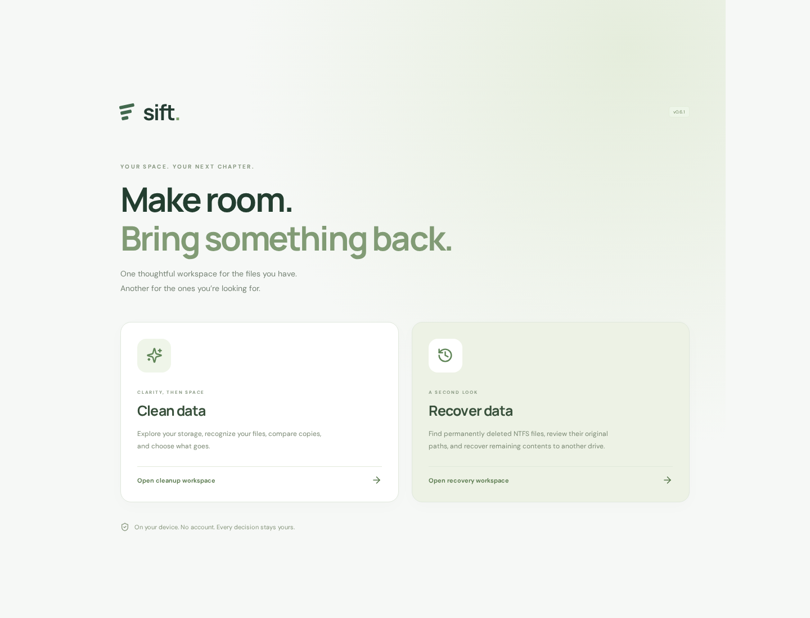
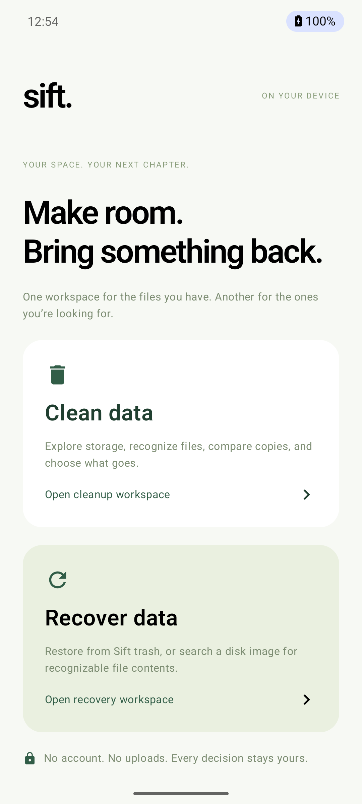

# Sift

**Your space, simplified.** Local storage cleanup and a disk-image recovery preview for desktop and Android. Desktop uses Rust, Tauri 2, React, and TypeScript; Android uses native Kotlin and Jetpack Compose.

[](https://github.com/sarvesh-kr/sift/actions/workflows/ci.yml)
[](https://github.com/sarvesh-kr/sift/actions/workflows/android.yml)
[](https://github.com/sarvesh-kr/sift/actions/workflows/build.yml)

**[Website & downloads](https://sift.sarvesh.si)** · [GitHub releases](https://github.com/sarvesh-kr/sift/releases) · [Build status](https://github.com/sarvesh-kr/sift/actions) · [Build/release instructions](docs/RELEASING.md)

| Device | Download |
| --- | --- |
| Windows x64 | `windows-x64-setup.exe` or `windows-x64-portable.zip` |
| Linux x64 | `linux-x64.deb` or `linux-x64.AppImage` |
| Apple Silicon Mac (M1 or newer) | `macos-apple-silicon.dmg` |
| Intel Mac | `macos-intel.dmg` |
| Android 11+ phone | Signed `Sift-0.3.0-android.apk` |

Installers and archives are attached to tagged preview releases after every platform build passes. Choose **Clean data** or **Recover data** at launch. The cleaning workspace starts with labeled sample data; click **Scan a folder** to index your own files.



Version **0.2.0** adds an explanation-based Cleanup Center, folder drill-down, volume capacity and available-space readings, staged duplicate comparison with separate byte verification, and retained-copy protection. See [the competitive goals and benchmark gates](PRODUCT-GOALS.md) for the path toward a leading storage-cleanup product. No superiority over commercial cleaners has been established.

Version **0.3.0** adds three explicit cleanup actions: Recycle Bin / trash (default), permanent deletion, and best-effort overwrite-and-delete. Apply them to one file, a selection, or all matches in the current filtered view, including unloaded rows. Permanent actions require typing the exact action and file count; removing all known duplicate copies also requires a separate acknowledgment. Windows recycling retains the isolated STA Shell worker, per-file errors, and verified bin destination from 0.2.1. Recycling never falls back to permanent deletion.

Version **0.4.0** on desktop and **0.2.0** on Android add saved **List / Grid**
views and local content previews across file browsing and cleanup review. Switching
views preserves filters and selections. File details provide a larger preview.
Images and plain text work on desktop; Windows additionally uses available system
thumbnail handlers for video, PDF, Office, and newer image formats. Android
supports images, video frames, PDF first pages, and plain text, including Sift
trash. Unsupported, protected, oversized, or unreadable files show their type.
Previews load on demand with bounded memory and decode concurrency. They do not
execute files, fetch remote resources, or change cleanup safety checks. Thumbnails
are a visual aid; inspect paths and retain backups before deletion.

## Clean data and Recover data

Desktop **0.5.0** and Android **0.3.0** open with two workspace choices. Existing
cleaning tools remain under **Clean data**. **Recover data** offers trash restore
and read-only carving of a user-picked local disk image, with categorized
JPEG/PNG/WebP/PDF/ZIP/WAV candidates, List / Grid views, image previews, evidence,
search, individual/all-match selection, and verified exports grouped by category.
SHA-256, destination read-back, exclusive outputs, and a JSON manifest preserve
the distinction between finding a byte range and recovering a readable file.

This is a **contiguous-carving preview**, not professional recovery parity:
original names, folders, deletion status, fragmented files, filesystem metadata
undelete, other formats, and files above 512 MiB are unsupported. PDF evidence is
header/footer only; ZIP payload CRCs are unverified. Android cannot undelete raw
encrypted internal storage through normal permissions. TRIM, overwriting, and
encryption can make recovery impossible. Image scanning uses the document picker
without All files access; shared-storage cleanup and Sift-trash restore still
need their existing permission. Desktop trash restore uses the OS file manager.

See [the recovery capabilities, safety model, and exact limits](docs/RECOVERY.md).
No universal-recovery or superiority claim is made.

## What works on desktop

- Select a local folder or drive with the native folder picker.
- Scan nested files on a background Rust thread, with progress and cancellation.
- Explore eight file categories, a proportional treemap, a size breakdown, and searchable/sortable file lists.
- Use Cleanup Center explanations to review large videos, older installers, archives, Downloads files, and recognized build/cache locations. Each rule describes its evidence and the consequences of removal.
- Drill into folders and open a file list scoped to any branch.
- View the selected folder's host volume capacity and available space, refreshed after cleanup.
- Choose a retained copy in each duplicate group and add only extras to review. Native cleanup independently validates a remaining copy and byte-compares it before moving a duplicate.
- Find content duplicates with size prefiltering, sampled-content prefiltering, streaming BLAKE3 hashing, and separate full byte comparisons. Hard links are excluded from duplicate-copy estimates where file identity is available; empty files are excluded.
- Inspect full paths and metadata; select files and review them before cleanup.
- Recycle selected files by default, or explicitly choose permanent deletion or overwrite-and-delete.
- Revalidate the scanned file identity and metadata before cleanup. Wipe performs one logical zero pass, flushes, verifies every byte, then deletes; it refuses hard links and Windows reparse/cloud, compressed, sparse, or encrypted files. Stop is available for permanent actions; any failed overwrite requires a new scan.
- Overwrite is **not certified media sanitization**: SSD wear leveling, copy-on-write, snapshots, backups, and synced copies may retain data. Sift cannot undo irreversible actions. Unix path operations cannot eliminate every race with unrelated processes; avoid concurrent file changes during cleanup.
- Export a JSON inventory and persist the reduced-motion preference.

Under **Clean data**, the desktop app initially shows a clearly labeled sample workspace. **Scan a folder** replaces the sample data with a real local scan. The browser preview uses sample data only and never modifies real files.

## Why this stack

Rust handles directory traversal, metadata, hashing, and trash operations without a Python or Node runtime. Tauri uses the operating system's webview instead of shipping a separate Chromium engine. The interface is a small static React/TypeScript bundle, with Lucide icons and locally bundled fonts. No server, accounts, analytics, network API, or cloud AI is involved.

The shared desktop code targets **Windows, macOS, and Linux**. Build an OS-specific package for each platform. The separate native Android client respects Android shared-storage restrictions; it does not run the desktop filesystem engine on a phone.

## Android phones



Download the signed APK from [the website](https://sift.sarvesh.si/#download) or
[Android releases](https://github.com/sarvesh-kr/sift/releases?q=android).
Android 11 or newer is required. Allow APK installation from your browser or file
manager when Android asks. Open Sift, choose **Clean data**, and explicitly enable its **All files access**
in system settings, return to the app, and scan shared phone storage.

The native client includes category browsing, large-file filtering, search,
exact duplicate comparison, individual and all-match selection, restorable
**Sift trash**, and typed confirmation for permanent deletion. It has no internet
permission, accounts, ads, accessibility service, or automatic background cleanup.
Other apps' private data, protected Android folders, system files, and RAM are
outside its scope. Scans are capped at 100,000 files.

**Sift trash still occupies storage, and uninstalling Sift removes that trash.**
Restore needed files before uninstalling; permanently empty selected trash items
to reclaim their space. Gallery trash is separate. There is no Android secure-wipe
claim for flash, backups, or cloud copies. Android APK versions are independent
of desktop releases. See [Android architecture, testing, signing, and release
instructions](docs/ANDROID.md). This is a sideloaded preview, not a Google Play
listing.

## Preview the interface

Requires Node.js 22+.

```sh
npm ci
npm run dev
```

Open `http://localhost:1420`. Choose **Clean data** to use the sample workspace and cleanup review. **Recover data** shows its capabilities; native image recovery is not simulated in the browser. **Scan a folder** explains that native access requires the desktop build.

## Run the desktop application

Install [Rust](https://rustup.rs/) and the [Tauri platform prerequisites](https://v2.tauri.app/start/prerequisites/).

- **Windows:** Microsoft C++ Build Tools (Desktop development with C++), Windows SDK, and WebView2.
- **macOS:** Xcode command line tools.
- **Debian/Ubuntu:** the Tauri prerequisites include `libwebkit2gtk-4.1-dev`, `build-essential`, `libxdo-dev`, `libssl-dev`, `librsvg2-dev`, and `libayatana-appindicator3-dev`.

```sh
npm ci
npm run tauri dev
```

## Build a Windows EXE

On Windows, after installing the prerequisites:

```powershell
npm ci
npm run tauri build -- --bundles nsis
```

The installer is in `src-tauri/target/release/bundle/nsis/`. The standalone executable is `src-tauri/target/release/sift.exe`; it still requires WebView2. The installer checks for WebView2 and can download it if missing.

For other platforms:

```sh
# Run on macOS
npm run tauri build -- --bundles dmg

# Run on Linux
npm run tauri build -- --bundles deb,appimage
```

The **Desktop builds** GitHub Actions workflow builds Windows x64, macOS Apple Silicon, macOS Intel, and Linux x64 packages on native hosted runners. A `v*` tag matching the manifest version triggers tests and builds, then publishes a GitHub preview release with installers, build metadata, and SHA-256 checksums. **Actions → Desktop builds → Run workflow** produces downloadable workflow artifacts without publishing a release. Windows ARM64 is not currently included. See [docs/RELEASING.md](docs/RELEASING.md).

Builds are unsigned. Public distribution should add Windows signing and macOS signing/notarization. This source does not contain signing credentials or an auto-update service.

## Validation

```sh
npm run build
cargo test --manifest-path native-core/Cargo.toml --locked
npx playwright install chromium
npm run test:ui
```

Rust tests exercise nested scanning, categorization, content-based duplicate detection, cancellation, hard-link handling, changed-file rejection, symlink redirection, and trash failures without deletion fallback, and explicit permanent deletion/overwrite on disposable test fixtures. Frontend tests cover folder-boundary accounting, recommendation explanations, credential-pattern exclusions, duplicate selection, navigation, search, cleanup review, sample-only removal, preference persistence, responsive layout, and keyboard focus.

## Storage-cleanup product goals

[PRODUCT-GOALS.md](PRODUCT-GOALS.md) records the official comparison sources, delivered behavior, remaining engineering milestones, and release gates for meaningful superiority claims. This release does not implement an NTFS MFT engine, a disk-backed inventory, application-specific browser/OS cache cleaners, certified media sanitization, in-app restore, or similar-image detection.

## Scope and practical limits

- Scan access follows the current user's OS permissions. Inaccessible entries are counted and skipped; the app does not elevate itself or bypass OS protections.
- Symlinks are skipped. Scans are capped at 500,000 files, with an explicit partial-result message. Network drives, junctions/reparse points, cloud placeholder files, and huge inventories need further platform-specific testing.
- Categories currently use file extensions. They do not identify document topics, similar photos, malware, unused application files, or safe-to-delete Windows components.
- Modification age is not last-use age. Cleanup suggestions are review candidates, not a guarantee that a file is disposable.
- Space totals are logical file sizes within the scan, not volume capacity, physical disk allocation, or guaranteed reclaimed bytes. Compression, sparse files, snapshots, hard links, and cloud storage can change actual space recovery.
- Duplicate checks read full contents for candidate files, so large scans can be limited by disk speed. Sampled matches are only a prefilter. Reported native groups pass complete BLAKE3 hashing and a separate byte comparison. Native cleanup repeats comparison against a remaining unchanged copy; it blocks removal of every detected copy in a group. No duplicate is automatically selected for removal.
- Trash operations revalidate the scan allowlist, canonical path, file type, size, modification timestamp, and available file identity. These checks reduce races but do not make cleanup a filesystem transaction. Files that fail validation remain in place. Restore files using the operating system's trash UI.
- Scan inventories stay in memory. Closing the application clears them; the app does not retain file paths in a database. Exported JSON reports intentionally contain file names and paths.
- The frontend renders a limited set of rows and offers **Load more**. Further work for very large inventories includes incremental IPC, a disk-backed index, virtualized rows, and native volume enumeration.

## Source layout

```text
src/                     React interface, categories, sample data, treemap
native-core/             Independently tested Rust scan/hash/trash library
src-tauri/               Native commands, desktop configuration, app icons
tests/                   Playwright interface checks
.github/workflows/       Per-platform package builds
website/                 GitHub Pages marketing and download website
```

The public website is hosted at **https://sift.sarvesh.si** with release-aware
downloads, app previews, and installation help. See [docs/WEBSITE.md](docs/WEBSITE.md)
for editing, local preview, and automatic GitHub Pages deployment.

The Rust scan session is the cleanup allowlist. The frontend has no generic filesystem or shell plugin permission. Bundled content uses a restrictive CSP; fonts and assets load locally.
