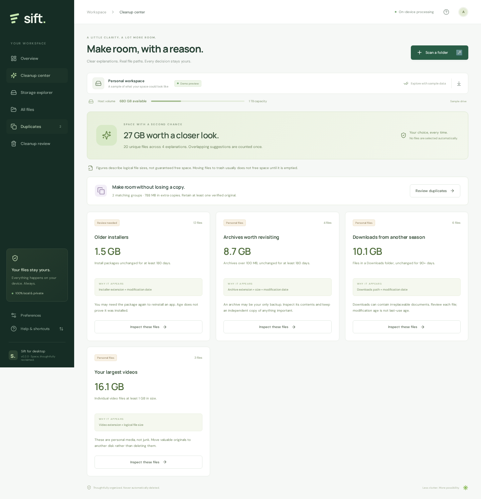

# Sift

**Your space, simplified.** A lightweight desktop file explorer and cleanup assistant, built with Rust, Tauri 2, React, and TypeScript.

[](https://github.com/sarvesh-kr/sift/actions/workflows/ci.yml)
[](https://github.com/sarvesh-kr/sift/actions/workflows/build.yml)

**[Website & downloads](https://sift.sarvesh.si)** · [GitHub releases](https://github.com/sarvesh-kr/sift/releases) · [Build status](https://github.com/sarvesh-kr/sift/actions) · [Build/release instructions](docs/RELEASING.md)

| Computer | Download |
| --- | --- |
| Windows x64 | `windows-x64-setup.exe` or `windows-x64-portable.zip` |
| Linux x64 | `linux-x64.deb` or `linux-x64.AppImage` |
| Apple Silicon Mac (M1 or newer) | `macos-apple-silicon.dmg` |
| Intel Mac | `macos-intel.dmg` |

Installers and archives are attached to tagged preview releases after every platform build passes. The initial workspace uses labeled sample data; click **Scan a folder** to index your own files.



Version **0.2.0** adds an explanation-based Cleanup Center, folder drill-down, volume capacity and available-space readings, staged duplicate comparison with separate byte verification, and retained-copy protection. See [the competitive goals and benchmark gates](PRODUCT-GOALS.md) for the path toward a leading storage-cleanup product. No superiority over commercial cleaners has been established.

Version **0.2.1** replaces Windows cleanup's generic “Some operations were aborted” error with explicit Recycle Bin operations, per-file Windows error codes and actionable hints, persistent cleanup results, and progress. Files are only counted as recycled after the Shell confirms a destination in the bin and the original path is absent. Successful files leave the selection; unconfirmed files stay in review. Windows runtime regression tests recycle and restore disposable fixtures and cover locked files without permanent-delete fallbacks.

## What works

- Select a local folder or drive with the native folder picker.
- Scan nested files on a background Rust thread, with progress and cancellation.
- Explore eight file categories, a proportional treemap, a size breakdown, and searchable/sortable file lists.
- Use Cleanup Center explanations to review large videos, older installers, archives, Downloads files, and recognized build/cache locations. Each rule describes its evidence and the consequences of removal.
- Drill into folders and open a file list scoped to any branch.
- View the selected folder's host volume capacity and available space, refreshed after cleanup.
- Choose a retained copy in each duplicate group and add only extras to review. Native cleanup independently validates a remaining copy and byte-compares it before moving a duplicate.
- Find content duplicates with size prefiltering, sampled-content prefiltering, streaming BLAKE3 hashing, and separate full byte comparisons. Hard links are excluded from duplicate-copy estimates where file identity is available; empty files are excluded.
- Inspect full paths and metadata; select files and review them before cleanup.
- Move selected files to the operating system's trash. There is no permanent-delete fallback.
- Export a JSON inventory and persist the reduced-motion preference.

The desktop app initially shows a clearly labeled sample workspace. **Scan a folder** replaces the sample data with a real local scan. The browser preview uses sample data only and never modifies real files.

## Why this stack

Rust handles directory traversal, metadata, hashing, and trash operations without a Python or Node runtime. Tauri uses the operating system's webview instead of shipping a separate Chromium engine. The interface is a small static React/TypeScript bundle, with Lucide icons and locally bundled fonts. No server, accounts, analytics, network API, or cloud AI is involved.

The shared desktop code targets **Windows, macOS, and Linux**. Build an OS-specific package for each platform. This project does not implement mobile disk cleanup: phone operating systems enforce different storage restrictions.

## Preview the interface

Requires Node.js 22+.

```sh
npm ci
npm run dev
```

Open `http://localhost:1420`. All interface interactions, including cleanup review, work on the sample workspace. **Scan a folder** explains that native access requires the desktop build.

## Run the desktop application

Install [Rust](https://rustup.rs/) and the [Tauri platform prerequisites](https://v2.tauri.app/start/prerequisites/).

- **Windows:** Microsoft C++ Build Tools (Desktop development with C++), Windows SDK, and WebView2.
- **macOS:** Xcode command line tools.
- **Debian/Ubuntu:** the Tauri prerequisites include `libwebkit2gtk-4.1-dev`, `build-essential`, `libxdo-dev`, `libssl-dev`, `librsvg2-dev`, and `libayatana-appindicator3-dev`.

```sh
npm ci
npm run tauri dev
```

## Build a Windows EXE

On Windows, after installing the prerequisites:

```powershell
npm ci
npm run tauri build -- --bundles nsis
```

The installer is in `src-tauri/target/release/bundle/nsis/`. The standalone executable is `src-tauri/target/release/sift.exe`; it still requires WebView2. The installer checks for WebView2 and can download it if missing.

For other platforms:

```sh
# Run on macOS
npm run tauri build -- --bundles dmg

# Run on Linux
npm run tauri build -- --bundles deb,appimage
```

The **Desktop builds** GitHub Actions workflow builds Windows x64, macOS Apple Silicon, macOS Intel, and Linux x64 packages on native hosted runners. A `v*` tag matching the manifest version triggers tests and builds, then publishes a GitHub preview release with installers, build metadata, and SHA-256 checksums. **Actions → Desktop builds → Run workflow** produces downloadable workflow artifacts without publishing a release. Windows ARM64 is not currently included. See [docs/RELEASING.md](docs/RELEASING.md).

Builds are unsigned. Public distribution should add Windows signing and macOS signing/notarization. This source does not contain signing credentials or an auto-update service.

## Validation

```sh
npm run build
cargo test --manifest-path native-core/Cargo.toml --locked
npx playwright install chromium
npm run test:ui
```

Rust tests exercise nested scanning, categorization, content-based duplicate detection, cancellation, hard-link handling, changed-file rejection, symlink redirection, and trash failures without permanently deleting files. Frontend tests cover folder-boundary accounting, recommendation explanations, credential-pattern exclusions, duplicate selection, navigation, search, cleanup review, sample-only removal, preference persistence, responsive layout, and keyboard focus.

## Storage-cleanup product goals

[PRODUCT-GOALS.md](PRODUCT-GOALS.md) records the official comparison sources, delivered behavior, remaining engineering milestones, and release gates for meaningful superiority claims. This release does not implement an NTFS MFT engine, a disk-backed inventory, application-specific browser/OS cache cleaners, permanent deletion, in-app restore, or similar-image detection.

## Scope and practical limits

- Scan access follows the current user's OS permissions. Inaccessible entries are counted and skipped; the app does not elevate itself or bypass OS protections.
- Symlinks are skipped. Scans are capped at 500,000 files, with an explicit partial-result message. Network drives, junctions/reparse points, cloud placeholder files, and huge inventories need further platform-specific testing.
- Categories currently use file extensions. They do not identify document topics, similar photos, malware, unused application files, or safe-to-delete Windows components.
- Modification age is not last-use age. Cleanup suggestions are review candidates, not a guarantee that a file is disposable.
- Space totals are logical file sizes within the scan, not volume capacity, physical disk allocation, or guaranteed reclaimed bytes. Compression, sparse files, snapshots, hard links, and cloud storage can change actual space recovery.
- Duplicate checks read full contents for candidate files, so large scans can be limited by disk speed. Sampled matches are only a prefilter. Reported native groups pass complete BLAKE3 hashing and a separate byte comparison. Native cleanup repeats comparison against a remaining unchanged copy; it blocks removal of every detected copy in a group. No duplicate is automatically selected for removal.
- Trash operations revalidate the scan allowlist, canonical path, file type, size, modification timestamp, and available file identity. These checks reduce races but do not make cleanup a filesystem transaction. Files that fail validation remain in place. Restore files using the operating system's trash UI.
- Scan inventories stay in memory. Closing the application clears them; the app does not retain file paths in a database. Exported JSON reports intentionally contain file names and paths.
- The frontend renders a limited set of rows and offers **Load more**. Further work for very large inventories includes incremental IPC, a disk-backed index, virtualized rows, and native volume enumeration.

## Source layout

```text
src/                     React interface, categories, sample data, treemap
native-core/             Independently tested Rust scan/hash/trash library
src-tauri/               Native commands, desktop configuration, app icons
tests/                   Playwright interface checks
.github/workflows/       Per-platform package builds
website/                 GitHub Pages marketing and download website
```

The public website is hosted at **https://sift.sarvesh.si** with release-aware
downloads, app previews, and installation help. See [docs/WEBSITE.md](docs/WEBSITE.md)
for editing, local preview, and automatic GitHub Pages deployment.

The Rust scan session is the cleanup allowlist. The frontend has no generic filesystem or shell plugin permission. Bundled content uses a restrictive CSP; fonts and assets load locally.
